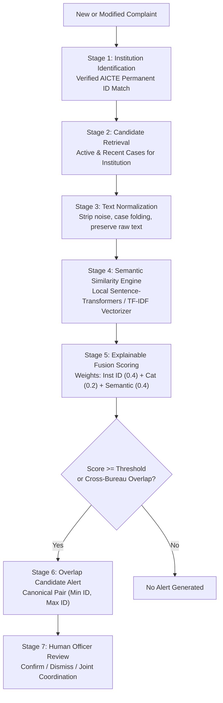

# AUGIS – AICTE Unified Grievance Intelligence System
## Intelligent Overlap Detection Engine: Hybrid Deterministic & Semantic Matching

---

### 1. Conceptual Distinction: Institution Overlap vs. Issue Overlap

A fundamental innovation in AUGIS is explicitly distinguishing between two very different operational events:
1. **Case A: Institution-Level Overlap**: Multiple independent complaints are lodged against the *same educational institution* across different AICTE bureaus (e.g., an unapproved program complaint in Regulation Bureau, and a capitation fee grievance in PGRC).
   - *Operational Meaning*: The institution may have broader governance or compliance challenges across departments.
2. **Case B: Issue-Level Overlap**: Multiple complaints across bureaus concern the *exact same underlying dispute or incident* (e.g., faculty salary withholding or campus laboratory deficiency reported both directly to PGRC and forwarded to Regional Office).
   - *Operational Meaning*: High risk of redundant investigations or conflicting findings.

---

### 2. Seven-Stage Matching Pipeline

#### Stage 1: Institution Identification
- Matches strictly on `aicte_permanent_id` when present.
- If missing, queries normalized institution names (`normalized_name`) and district/state.
- Never silently links unrelated institutions.

#### Stage 2: Candidate Retrieval
- Limits candidate search space to:
  - Same institution complaints in `PENDING`, `UNDER_PROCESS`, or `ESCALATED` status.
  - Complaints received within the preceding 365 days.
  - Flags cross-bureau cases (`complaint.currently_assigned_bureau != candidate.currently_assigned_bureau`).

#### Stage 3: Unicode-Aware Multilingual Text Normalization
- Converts text to NFKC normalized form.
- Strips punctuation and symbols (`unicodedata.category(c).startswith(('P', 'S'))`) while preserving all Indic combining characters and nonspacing vowel signs (Tamil, Hindi Devanagari, Bengali, Telugu, etc.).
- The original complainant description is **always preserved unchanged** in the database.

#### Stage 4: Semantic Similarity Engine
- **Primary Model**: HuggingFace `sentence-transformers/all-MiniLM-L6-v2` (lightweight, ~80MB, fast CPU inference, 384-dimensional dense vectors, Apache 2.0 license).
- **Graceful Fallback**: Unicode-aware hybrid Scikit-Learn `TfidfVectorizer` (50% word n-gram + 50% character-boundary 3-5 ngrams) cosine similarity.
- **Asynchronous Execution**: Decoupled from intake via Django `transaction.on_commit(queue_intelligence_job)` and `IntelligenceJob` background processor.

#### Stage 5: Decoupled Explainable Scoring Formula
Crucially, AUGIS V2 decouples **Category A** (Institution-Level Cross-Bureau Alert) from **Category B** (Substantive Issue Similarity):
- **Category A (Institution Alert)**: Triggered when two distinct Bureaus concurrently investigate active cases against the same college (`is_institution_level_alert = True`). It signals institutional compliance risk without falsely declaring cases to be duplicate grievances.
- **Category B (Potentially Related Issue)**: Evaluates pure factual and semantic issue overlap:
$$S_{issue} = 0.65 \cdot S_{sem} + 0.35 \cdot M_{cat}$$
Where:
- $S_{sem} \in [0.0, 1.0]$ is cosine text similarity between title + description.
- $M_{cat} = 1.0$ if complaint category matches, $0.0$ otherwise.
- **No False Duplicates**: Institution ID match is **not** added as a weight to $S_{issue}$, ensuring two completely different grievances against the same college (e.g. fire safety vs exam leak) never receive inflated similarity scores.

#### Stage 6: Canonical Pair Deduplication
To ensure that comparing Complaint A and Complaint B does not generate two duplicate records `(A, B)` and `(B, A)`:
- The pair is always ordered canonically: `first_id = min(A.id, B.id)`, `second_id = max(A.id, B.id)`.
- Enforced with database `CheckConstraint` and `UniqueConstraint`.

#### Stage 7: Human Review & Decision Support
- Authorized Bureau Heads review the candidate in the **Intelligence Center**.
- Explanatory factors are rendered visually:
  - ✅ Exact AICTE Permanent ID Match: `1-AICTE-984210`
  - ⚠️ Cross-Bureau Alert: Handled by **Regulation Bureau** vs **PGRC**
  - 📊 Semantic Text Similarity: `84.2%`
  - 📝 Shared keywords: "laboratories, equipment, computer center, affiliation norms"
- Action buttons:
  - `[Confirm Related Cases]` -> Links in `CaseRelationship`
  - `[Dismiss as False Positive]` -> Records dismissal remarks
  - `[Mark as Separate Issues]` -> Retains separate tracking without alert repetition
  - `[Initiate Joint Coordination]` -> Creates `CoordinationRecord`
