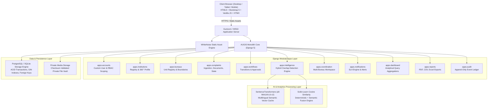

# AUGIS – AICTE Unified Grievance Intelligence System
## System Architecture & Technical Specification

---

### 1. High-Level Architectural Model

AUGIS is designed as an enterprise-grade **Python-centric modular monolith** built on Django 5.x. It avoids external Node.js/npm dependencies, single-page application complexities, and distributed microservice overhead while delivering high performance, strict ACID guarantees, and security isolation.



---

### 2. Design Principles & Technical Choices

| Dimension | Architectural Choice | Technical Rationale |
|---|---|---|
| **Core Framework** | Django 5.x (Python 3.12) | Mature ORM, built-in security protections (CSRF, XSS, SQLi), enterprise authentication, and robust migration engine. |
| **Frontend Strategy** | Django Templates + Bootstrap 5 + HTMX | Server-rendered HTML with zero build step (no Webpack, Vite, npm). HTMX enables snappy partial-page updates (e.g., notification drawer, filtering, dynamic overlap review) without single-page app fragility. |
| **Presentation & Aesthetics** | Custom Modern CSS Design System | Curated deep-blue enterprise palette (`#12345A`, `#2563EB`, `#F5F7FB`, `#15803D`, `#B91C1C`), typography with Google Outfit/Inter fonts, micro-animations, glassmorphic touches, and accessible contrast. |
| **Database Strategy** | PostgreSQL with SQLite local auto-fallback | Strict foreign keys, UUID primary keys for entity protection, canonical pair constraints for overlap relationships, and atomic transaction blocks. |
| **Document Security** | Private Media Vault (Streaming View) | Uploaded complaints files (PDF, images) are never exposed via public static/media URLs. Access is gated via `apps.complaints.views.document_download_view` which verifies bureau and role permissions. |
| **AI Strategy** | Local Hybrid Engine with Fallback | Sentence-transformers (`all-MiniLM-L6-v2`) cached locally with fallback to TF-IDF & deterministic institution matching when PyTorch/Transformers are warming up or constrained. Zero paid APIs, zero data privacy leakage. |

---

### 3. Layer Separation & Code Organization

```text
augis/
├── manage.py
├── requirements.txt
├── .env.example
├── Dockerfile
├── docker-compose.yml
├── config/
│   ├── __init__.py
│   ├── settings/
│   │   ├── __init__.py
│   │   ├── base.py
│   │   ├── development.py
│   │   └── production.py
│   ├── urls.py
│   ├── wsgi.py
│   └── asgi.py
├── apps/
│   ├── accounts/       # User model, RBAC roles, auth views, centralized access_policy & queryset_scoping
│   ├── institutions/   # Institution entity, registry, search, 360° dossier
│   ├── bureaus/        # AICTE Bureau/Cell models, regional offices
│   ├── complaints/     # Complaint entity, ComplaintSequence concurrency counter, magic byte documents
│   ├── workflows/      # Status state machine, transitions, approval ledger
│   ├── intelligence/   # Decoupled Overlap Engine, Unicode normalizer, vector cache, IntelligenceJob
│   ├── coordination/   # Joint bureau records, CoordinationSequence counter, shared timeline
│   ├── notifications/  # SLA policies, breach detector, in-app alerts
│   ├── dashboard/      # Role-tailored operational & analytical metrics
│   ├── reports/        # Formula-injection-sanitized export engines (CSV, XLSX, PDF via ReportLab)
│   └── audit/          # Immutable audit events and request correlation
├── templates/
│   ├── base.html       # Base layout with sidebar, navbar, toasts, modals
│   ├── partials/       # Reusable components (pagination, empty states, badges)
│   ├── accounts/
│   ├── dashboard/
│   ├── institutions/
│   ├── complaints/
│   ├── intelligence/
│   ├── coordination/
│   └── reports/
├── static/
│   ├── css/            # Custom enterprise design system (tokens, themes, tables)
│   ├── js/             # UI helpers, HTMX integration, Chart.js configs
│   └── images/         # Icons, synthetic institution badges
└── tests/              # Automated test suites covering T01 - T30 + V2 Hardening Suites (57 tests)
```

---

### 4. Data Flow: Cross-Bureau Ingestion & Overlap Detection (V2)

1. **Ingestion**: Case Officer or Bureau Head enters complaint with AICTE Permanent ID (or selects matching institution).
2. **Safe ID Generation**: Concurrency-safe atomic increment via `ComplaintSequence` with row-level `select_for_update()` lock yields ID e.g., `AICTE-2026-PGRC-00104`.
3. **Decoupled Asynchronous Overlap Trigger**:
   - `transaction.on_commit()` queues an `IntelligenceJob` record in the database.
   - Background worker or synchronous signal executes `OverlapDetectionService.detect_overlaps_for_complaint(complaint)`.
   - **Step A**: Query existing active and recent complaints associated with the same `Institution.id`.
   - **Step B (Category A)**: Evaluates whether multiple distinct Bureaus are actively handling cases for this institution (`is_institution_level_alert = True`).
   - **Step C (Category B)**: Computes semantic similarity across title + description and category correlation.
   - **Step D**: If Category A or Category B conditions are met, creates canonical `OverlapCandidate` pair with transparent detection category.
4. **Alert Notification**:
   - In-app notification alerts Bureau Heads of both Bureaus.
5. **Human Review & Action**:
   - Bureau Head inspects the Explainable Overlap Dossier.
   - If confirmed, clicking **"Initiate Joint Coordination"** establishes a `CoordinationRecord` without altering the original complaints.
