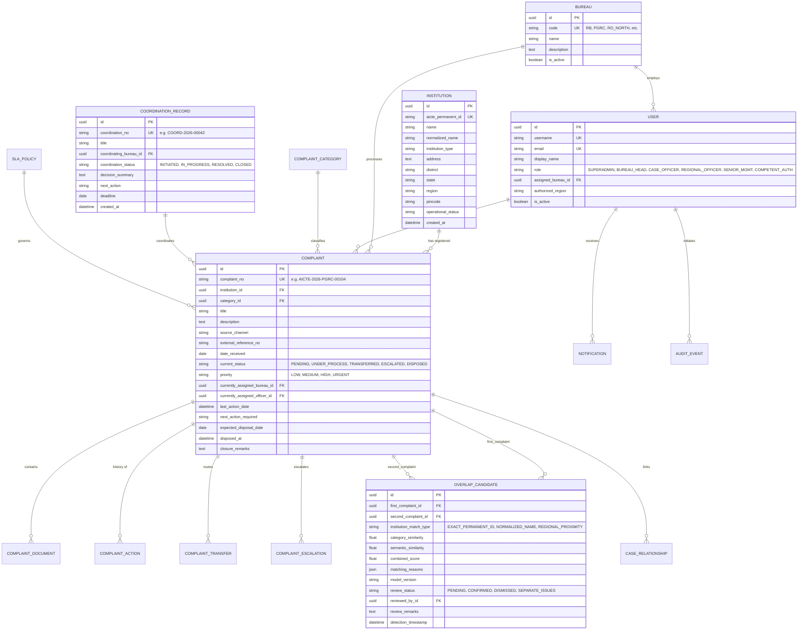

# AUGIS – AICTE Unified Grievance Intelligence System
## Database Schema & Entity Relationship Specification

---

### 1. Relational Database Design Summary

- **Primary Storage**: PostgreSQL (with SQLite compatibility in local development).
- **Primary Keys**: UUID v4 for all business entities (eliminates enumeration attacks and eases distributed replication).
- **Audit Integrity**: Append-only design for `AuditEvent` and `ComplaintAction`.
- **Integrity Constraints**: Canonical pair ordering on `OverlapCandidate` (`first_complaint_id < second_complaint_id`) prevents duplicate reversed pairs.
- **Index Optimization**: Composite indexes on frequently queried search fields: `(institution_id, current_status)`, `(assigned_bureau_id, current_status)`, and `(aicte_permanent_id)`.

---

### 2. Entity Relationship Diagram (Mermaid)

---

### 3. Detailed Model Schemas & Constraints

#### `apps.institutions.Institution`
- `id` (UUIDField, primary_key=True, default=uuid4)
- `aicte_permanent_id` (CharField, max_length=50, unique=True, db_index=True)
- `name` (CharField, max_length=255, db_index=True)
- `normalized_name` (CharField, max_length=255, db_index=True) — Lowercase, punctuation-stripped, stopwords removed for fuzzy candidate screening
- `institution_type` (CharField, max_length=50) — `ENGINEERING`, `MANAGEMENT`, `PHARMACY`, `POLYTECHNIC`, `ARCHITECTURE`, etc.
- `address` (TextField)
- `district` (CharField, max_length=100)
- `state` (CharField, max_length=100)
- `region` (CharField, max_length=50, db_index=True) — e.g., `NORTHERN`, `SOUTHERN`, `WESTERN`, `EASTERN`, `CENTRAL`
- `pincode` (CharField, max_length=10)
- `contact_email` (EmailField, blank=True)
- `contact_phone` (CharField, max_length=20, blank=True)
- `operational_status` (CharField, max_length=30, default='ACTIVE') — `ACTIVE`, `UNDER_SCRUTINY`, `CLOSED`, `APPROVAL_WITHHELD`
- `created_at` (DateTimeField, auto_now_add=True)
- `updated_at` (DateTimeField, auto_now=True)

#### `apps.bureaus.Bureau`
- `id` (UUIDField, primary_key=True, default=uuid4)
- `code` (CharField, max_length=20, unique=True) — `RB`, `PGRC`, `RO_NORTH`, `RO_SOUTH`, `APPROVAL_BUREAU`
- `name` (CharField, max_length=100)
- `description` (TextField, blank=True)
- `is_active` (BooleanField, default=True)

#### `apps.accounts.User` (Custom User Model)
- Inherits from `AbstractBaseUser`, `PermissionsMixin`
- `id` (UUIDField, primary_key=True, default=uuid4)
- `username` (CharField, max_length=150, unique=True)
- `email` (EmailField, unique=True)
- `display_name` (CharField, max_length=150)
- `role` (CharField, max_length=30) — `SUPER_ADMIN`, `BUREAU_HEAD`, `CASE_OFFICER`, `REGIONAL_OFFICER`, `SENIOR_MGMT`, `COMPETENT_AUTH`
- `assigned_bureau` (ForeignKey to Bureau, null=True, blank=True, on_delete=SET_NULL)
- `authorized_region` (CharField, max_length=50, blank=True) — For Regional Officers
- `is_active` (BooleanField, default=True)
- `is_staff` (BooleanField, default=False)
- `created_at` (DateTimeField, auto_now_add=True)

#### `apps.complaints.Complaint`
- `id` (UUIDField, primary_key=True, default=uuid4)
- `complaint_no` (CharField, max_length=50, unique=True, db_index=True)
- `institution` (ForeignKey to Institution, on_delete=PROTECT, related_name='complaints')
- `title` (CharField, max_length=255)
- `description` (TextField)
- `category` (ForeignKey to ComplaintCategory, on_delete=PROTECT)
- `source_channel` (CharField, max_length=50) — `PORTAL`, `CPGRAMS_FORWARD`, `EMAIL`, `PHYSICAL_LETTER`, `REGULATORY_INSPECTION`
- `external_reference_no` (CharField, max_length=100, blank=True)
- `date_received` (DateField, default=timezone.now)
- `current_status` (CharField, max_length=30, default='PENDING', db_index=True)
- `priority` (CharField, max_length=20, default='MEDIUM')
- `currently_assigned_bureau` (ForeignKey to Bureau, on_delete=PROTECT, related_name='assigned_complaints')
- `currently_assigned_officer` (ForeignKey to User, null=True, blank=True, on_delete=SET_NULL, related_name='officer_complaints')
- `last_action_date` (DateTimeField, auto_now=True)
- `next_action_required` (CharField, max_length=255, blank=True)
- `expected_disposal_date` (DateField, null=True, blank=True)
- `applicable_sla_policy` (ForeignKey to SLAPolicy, null=True, blank=True, on_delete=SET_NULL)
- `created_by` (ForeignKey to User, on_delete=SET_NULL, null=True, related_name='created_complaints')
- `disposed_at` (DateTimeField, null=True, blank=True)
- `closure_remarks` (TextField, blank=True)
- `created_at` (DateTimeField, auto_now_add=True)
- `updated_at` (DateTimeField, auto_now=True)

#### `apps.complaints.ComplaintSequence`
- `id` (AutoField, primary_key=True)
- `bureau_code` (CharField, max_length=20, db_index=True)
- `year` (IntegerField, db_index=True)
- `last_number` (IntegerField, default=0)
- **UniqueConstraint**: `['bureau_code', 'year']`
- *Purpose*: Concurrency-safe atomic counter for `generate_complaint_number` using row-level locking (`select_for_update()`).

#### `apps.coordination.CoordinationSequence`
- `id` (AutoField, primary_key=True)
- `year` (IntegerField, unique=True, db_index=True)
- `last_number` (IntegerField, default=0)
- *Purpose*: Concurrency-safe atomic counter for `generate_coordination_number` using row-level locking (`select_for_update()`).

#### `apps.intelligence.IntelligenceJob`
- `id` (UUIDField, primary_key=True, default=uuid4)
- `complaint` (ForeignKey to Complaint, on_delete=CASCADE, related_name='intelligence_jobs')
- `status` (CharField, choices: `PENDING`, `PROCESSING`, `COMPLETED`, `FAILED`, default=`PENDING`, db_index=True)
- `retry_count` (IntegerField, default=0)
- `error_message` (TextField, blank=True)
- `created_at` (DateTimeField, auto_now_add=True, db_index=True)
- `processed_at` (DateTimeField, null=True, blank=True)
- *Purpose*: Background asynchronous job queue processed via `process_intelligence_jobs` management command.

#### `apps.intelligence.OverlapCandidate` (V2 Decoupled Architecture)
- `id` (UUIDField, primary_key=True, default=uuid4)
- `first_complaint` (ForeignKey to Complaint, on_delete=CASCADE, related_name='overlaps_as_first')
- `second_complaint` (ForeignKey to Complaint, on_delete=CASCADE, related_name='overlaps_as_second')
- `institution_match_type` (CharField, max_length=50)
- `detection_category` (CharField, choices: `INSTITUTION_CROSS_BUREAU`, `POTENTIALLY_RELATED_ISSUE`, `DUAL_OVERLAP`, db_index=True)
- `is_institution_level_alert` (BooleanField, default=False, db_index=True) — Category A alert
- `is_issue_level_overlap` (BooleanField, default=False, db_index=True) — Category B overlap
- `category_similarity` (FloatField, default=0.0)
- `semantic_similarity` (FloatField, default=0.0)
- `combined_score` (FloatField, default=0.0, db_index=True)
- `matching_reasons` (JSONField, default=list)
- `model_version` (CharField, max_length=50, default='minilm-l6-v2-local')
- `detection_timestamp` (DateTimeField, auto_now_add=True)
- `review_status` (CharField, max_length=30, default='PENDING', db_index=True)
- `reviewed_by` (ForeignKey to User, null=True, blank=True, on_delete=SET_NULL)
- `review_remarks` (TextField, blank=True)
- **CheckConstraint**: `overlap_candidate_no_self_link` (`~Q(first_complaint=F('second_complaint'))`)
- **CheckConstraint**: `canonical_pair_order` (`first_complaint_id < second_complaint_id`)

#### `apps.complaints.CaseRelationship`
- `id` (UUIDField, primary_key=True, default=uuid4)
- `source_complaint` (ForeignKey to Complaint, on_delete=CASCADE, related_name='source_relationships')
- `target_complaint` (ForeignKey to Complaint, on_delete=CASCADE, related_name='target_relationships')
- `relationship_type` (CharField, choices: `CONFIRMED_RELATED`, `DUPLICATE`, `PARENT_CHILD`, `PREVIOUS_INCIDENT`)
- `remarks` (TextField, blank=True)
- `created_by` (ForeignKey to User, null=True, on_delete=SET_NULL)
- `created_at` (DateTimeField, auto_now_add=True)
- **CheckConstraint**: `case_relationship_no_self_link` (`~Q(source_complaint=F('target_complaint'))`)

#### `apps.coordination.CoordinationRecord`
- `id` (UUIDField, primary_key=True, default=uuid4)
- `coordination_no` (CharField, max_length=50, unique=True)
- `title` (CharField, max_length=255)
- `coordinating_bureau` (ForeignKey to Bureau, on_delete=PROTECT, related_name='coordinated_records')
- `participating_bureaus` (ManyToManyField to Bureau, related_name='participating_coordinations')
- `related_complaints` (ManyToManyField to Complaint, related_name='coordination_records')
- `responsible_officers` (ManyToManyField to User, related_name='assigned_coordinations')
- `coordination_status` (CharField, max_length=30, default='INITIATED')
- `decision_summary` (TextField, blank=True)
- `next_action` (CharField, max_length=255, blank=True)
- `deadline` (DateField, null=True, blank=True)
- `created_by` (ForeignKey to User, on_delete=SET_NULL, null=True)
- `created_at` (DateTimeField, auto_now_add=True)
- `updated_at` (DateTimeField, auto_now=True)

#### `apps.audit.AuditEvent`
- `id` (UUIDField, primary_key=True, default=uuid4)
- `actor` (ForeignKey to User, null=True, on_delete=SET_NULL)
- `actor_username` (CharField, max_length=150)
- `event_type` (CharField, max_length=50, db_index=True) — `LOGIN`, `STATUS_TRANSITION`, `ASSIGNMENT`, `TRANSFER_REQUEST`, `OVERLAP_REVIEW`, `DOCUMENT_UPLOAD`, etc.
- `entity_name` (CharField, max_length=50)
- `entity_id` (CharField, max_length=100)
- `change_summary` (JSONField, default=dict)
- `ip_address` (GenericIPAddressField, null=True, blank=True)
- `correlation_id` (CharField, max_length=100, blank=True)
- `timestamp` (DateTimeField, auto_now_add=True, db_index=True)
