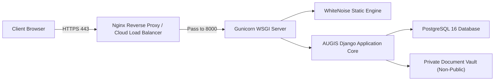

# AUGIS – AICTE Unified Grievance Intelligence System
## Production Deployment & Operational Runbook

---

### 1. Architectural Deployment Model

AUGIS is structured as a high-performance Python/Django monolithic application with:
- **Application Server**: Gunicorn WSGI with 3 to 4 worker processes.
- **Static Asset Delivery**: WhiteNoise with `CompressedManifestStaticFilesStorage` for cache busting and Brotli/Gzip compression.
- **Authoritative Database**: PostgreSQL 16 with indexed relational constraints and connection pooling.
- **Private Media Vault**: File-system storage outside webroot, served strictly through authenticated streaming endpoints.



---

### 2. Deployment via Docker & Docker Compose (Recommended)

#### Step 1: Configure Environment Variables
Copy `.env.example` to `.env` and set secure credentials:
```bash
cp .env.example .env
```
Ensure you set:
- `DJANGO_SECRET_KEY`: A high-entropy random string (>= 50 chars).
- `POSTGRES_DB`: `augis_db`
- `POSTGRES_USER`: `augis_user`
- `POSTGRES_PASSWORD`: Strong database password.
- `DEBUG`: `False`
- `ALLOWED_HOSTS`: Your domain name or IP (e.g. `augis.aicte-india.org`).

#### Step 2: Build and Run Containers
```bash
docker compose up -d --build
```

#### Step 3: Verify Status and Database Migrations
```bash
docker compose ps
docker compose logs -f web
```
The web container automatically runs database migrations and seeds synthetic demonstration data on initial start.

---

### 3. Local Development Deployment (Windows PowerShell)

#### Prerequisites
- Python 3.12 64-bit installed.
- PowerShell 5.1 or 7.x.

#### Step 1: Clone & Setup Virtual Environment
```powershell
cd "c:\deepak\coding\College Complaints"
python -m venv .venv
.\.venv\Scripts\Activate.ps1
```

#### Step 2: Install Python Dependencies
```powershell
pip install --upgrade pip
pip install -r requirements.txt
```

#### Step 3: Configure Environment
Copy `.env.example` to `.env`:
```powershell
Copy-Item .env.example .env
```

#### Step 4: Run Migrations and Seed Demo Data
```powershell
python manage.py makemigrations
python manage.py migrate
python manage.py seed_augis_demo
python manage.py collectstatic --noinput
```

#### Step 5: Start Development Server
```powershell
python manage.py runserver 127.0.0.1:8000
```
Open your browser at `http://127.0.0.1:8000/accounts/login/`.

---

### 4. Background Scheduled Tasks (SLA Scanner)

In production, run the idempotent SLA compliance scanner via cron or Windows Task Scheduler every 30 minutes:

#### Linux Crontab:
```cron
*/30 * * * * cd /app && /app/.venv/bin/python manage.py check_sla_breaches >> /var/log/augis_sla.log 2>&1
```

#### Windows Task Scheduler (PowerShell):
```powershell
$Action = New-ScheduledTaskAction -Execute "C:\deepak\coding\College Complaints\.venv\Scripts\python.exe" -Argument "manage.py check_sla_breaches" -WorkingDirectory "C:\deepak\coding\College Complaints"
$Trigger = New-ScheduledTaskTrigger -Daily -At "08:00AM"
Register-ScheduledTask -TaskName "AUGIS_SLA_Scanner" -Action $Action -Trigger $Trigger
```
