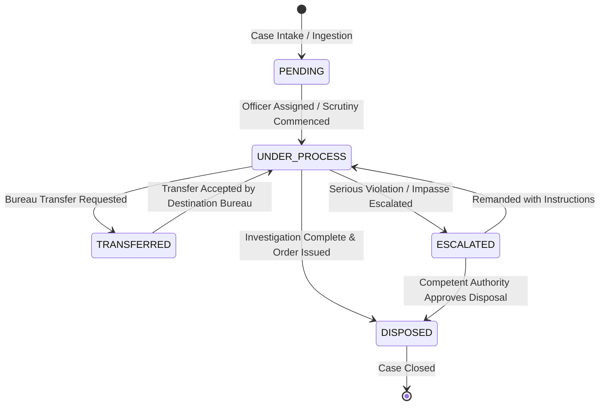

# AUGIS – AICTE Unified Grievance Intelligence System
## Complaint Workflow State Machine & Transition Rules

---

### 1. State Machine Definition

The Complaint lifecycle is governed by a deterministic, finite state machine (FSM). Every state transition is executed within an atomic database transaction (`transaction.atomic`) and logged to both the `ComplaintAction` history and the immutable `AuditEvent` ledger.

---

### 2. Transition Rules & Precondition Matrix

| From State | To State | Trigger / Action | Authorized Actors | Required Preconditions | Side Effects |
|---|---|---|---|---|---|
| **PENDING** | **UNDER_PROCESS** | Assign Officer or Begin Scrutiny | BUREAU_HEAD, SUPER_ADMIN | Assigned officer or handling bureau specified. Action remarks provided. | `last_action_date` updated; in-app notification sent to assigned officer. |
| **UNDER_PROCESS** | **TRANSFERRED** | Inter-Bureau Transfer Request | CASE_OFFICER, BUREAU_HEAD | Destination bureau must differ from current bureau. Transfer justification mandatory. | `ComplaintTransfer` record created; destination Bureau Head alerted. |
| **TRANSFERRED** | **UNDER_PROCESS** | Accept Transfer | Destination BUREAU_HEAD | Re-assignment of officer within new bureau. | `currently_assigned_bureau` updated; `ComplaintTransfer.approval_status` marked APPROVED. |
| **UNDER_PROCESS** | **ESCALATED** | Escalate to Authority | CASE_OFFICER, BUREAU_HEAD | Reason for escalation (e.g. non-cooperation, statutory risk) and escalation level required. | `ComplaintEscalation` record created; Competent Authority notified. |
| **ESCALATED** | **UNDER_PROCESS** | Remand / Clarification | COMPETENT_AUTH | Remand instructions provided. | Status returned to Under Process; case officer notified to gather further evidence. |
| **UNDER_PROCESS** | **DISPOSED** | Close Complaint | BUREAU_HEAD, SUPER_ADMIN | Detailed closure remarks, order reference, and resolution summary mandatory. | `disposed_at` timestamp recorded; resolution summary saved; related coordination notified. |
| **ESCALATED** | **DISPOSED** | Competent Authority Disposal | COMPETENT_AUTH, SUPER_ADMIN | Formal Competent Authority order reference and decision summary mandatory. | `disposed_at` timestamp set; final closure remarks logged. |

---

### 3. Transition Safeguards & Invariants

1. **Terminal State**: `DISPOSED` is terminal under standard workflows. Reopening a disposed case requires explicit Super Administrator override with audit logging.
2. **Atomic Rollback**: If logging `ComplaintAction` or creating a transfer/escalation entity fails during transition, the entire transaction rolls back; the complaint remains in its prior state.
3. **No Phantom Transitions**: Transition requests with invalid state jumps (e.g., `PENDING` directly to `DISPOSED` without scrutiny) raise a `WorkflowValidationError` and are rejected with HTTP 400.
4. **Coordination Conflict Awareness**: If a complaint is currently part of an active `CoordinationRecord`, a warning is displayed when requesting disposal or transfer to prevent uncoordinated unilateral action.
